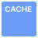

# Resource Icons

## Container

<table>
<tr>
    <th rowspan="2">Service</th>
    <th rowspan="2">Resource</th>
    <th colspan="2">PNG</th>
    <th colspan="2">SVG</th>
  </tr>
      <tr>
        <th>color</th>
        <th>black</th>
        <th>color</th>
        <th>black</th>
    </tr>
  <tr>
    <td>NKS</td>
    <td>Container</td>
    <td></td>
    <td></td>
    <td></td>
    <td></td>    
  </tr>
  <tr>
    <td rowspan="2">NCR</td>
    <td>Registry</td>
    <td></td>
    <td></td>
    <td></td>
    <td></td>    
  </tr>
    <tr>
    <td>Image</td>
    <td></td>
    <td></td>
    <td></td>
    <td></td>    
  </tr>
</table>

## Network

<table>
<tr>
    <th rowspan="2">Service</th>
    <th rowspan="2">Resource</th>
    <th colspan="2">PNG</th>
    <th colspan="2">SVG</th>
  </tr>
      <tr>
        <th>color</th>
        <th>black</th>
        <th>color</th>
        <th>black</th>
    </tr>
  <tr>
    <td rowspan="3">VPC</td>
    <td>Router</td>
    <td></td>
    <td></td>
    <td></td>
    <td></td>    
  </tr>
  <tr>
    <td>Routing Table</td>
    <td></td>
    <td></td>
    <td></td>
    <td></td>    
  </tr>
   <tr>
    <td>Peering connection</td>
    <td></td>
    <td></td>
    <td></td>
    <td></td>    
    </tr>
    <tr>
    <td>Transithub</td>
     <td>Attachment</td>
    <td></td>
    <td></td>
    <td></td>
    <td></td>    
  </tr>
    <tr>
    <td>Colocation Gateway</td>
    <td>NHN Cloud Zone</td>
    <td></td>
    <td></td>
    <td></td>
    <td></td>    
    </tr>
      <tr>
    <td>VPN Gateway(Site-to-Site VPN)</td>
    <td>VPN connection</td>
    <td></td>
    <td></td>
    <td></td>
    <td></td>   
    </tr>
    <tr> 
        <td rowspan="2">DNS Plus</td>
    <td>DNS</td>
    <td></td>
    <td></td>
    <td></td>
    <td></td>   
    </tr>
    <tr> 
      <td>GSLB</td>
      <td></td>
    <td></td>
    <td></td>
    <td></td>    
  </tr>
</table>

## Storage

<table>
<tr>
    <th rowspan="2">Service</th>
    <th rowspan="2">Resource</th>
    <th colspan="2">PNG</th>
    <th colspan="2">SVG</th>
  </tr>
      <tr>
        <th>color</th>
        <th>black</th>
        <th>color</th>
        <th>black</th>
    </tr>
  <tr>
  <tr>
    <td rowspan="2">Block Storage</td>
    <td>Volume</td>
    <td></td>
    <td></td>
    <td></td>
    <td></td>    
  </tr>
  <tr>
      <td>Snapshot</td>
    <td></td>
    <td></td>
    <td></td>
    <td></td>    
  </tr>
  <tr>
    <td>NAS</td>
    <td>File System</td>
    <td></td>
    <td></td>
    <td></td>
    <td></td>    
  </tr>
    <tr>
    <td rowspan="4">Backup</td>
    <td>Backup Policy</td>
    <td></td>
    <td></td>
    <td></td>
    <td></td>    
  </tr>
  <tr>
      <td>Backup Store</td>
    <td></td>
    <td></td>
    <td></td>
    <td></td>    
  </tr>
  <tr>
        <td>Backup Replication</td>
    <td></td>
    <td></td>
    <td></td>
    <td></td>    
    </tr>
  <tr>
      <td>Backup Recovery</td>
    <td></td>
    <td></td>
    <td></td>
    <td></td>    
  </tr>
  <tr>
    <td rowspan="3">Obejct Storage</td>
    <td>Object Storage Container</td>
    <td></td>
    <td></td>
    <td></td>
    <td></td>    
  </tr>
  <tr>
      <td>Container Replication</td>
    <td></td>
    <td></td>
    <td></td>
    <td></td>    
  </tr>
  <tr>
        <td>Object</td>
    <td></td>
    <td></td>
    <td></td>
    <td></td>    
    </tr>
    <tr>
    <td>Data Transporter</td>
    <td>Data Transporter import export</td>
    <td></td>
    <td></td>
    <td></td>
    <td></td>    
  </tr>
</table>

## Database

  
<table>
<tr>
    <th rowspan="2">Service</th>
    <th rowspan="2">Resource</th>
    <th colspan="2">PNG</th>
    <th colspan="2">SVG</th>
  </tr>
      <tr>
        <th>color</th>
        <th>black</th>
        <th>color</th>
        <th>black</th>
    </tr>
  <tr>
    <td>RDS for MySQL RDS for PostgreSQL RDS for MariaDB RDS for MS-SQL</td>
    <td>RDS Instance</td>
    <td></td>
    <td></td>
    <td></td>
    <td></td>    
  </tr>
  <tr>
    <td>NAS</td>
    <td>File System</td>
    <td></td>
    <td></td>
    <td></td>
    <td></td>    
  </tr>
</table>

## Monitoring

<table>
<tr>
    <th rowspan="2">Service</th>
    <th rowspan="2">Resource</th>
    <th colspan="2">PNG</th>
    <th colspan="2">SVG</th>
  </tr>
      <tr>
        <th>color</th>
        <th>black</th>
        <th>color</th>
        <th>black</th>
    </tr>
  <tr>
    <td rowspan="2">Cloud Monitoring</td>
    <td>Dashboard</td>
    <td></td>
    <td></td>
    <td></td>
    <td></td>    
  </tr>
  <tr>
      <td>Notification</td>
    <td></td>
    <td></td>
    <td></td>
    <td></td>    
    </tr>
</table>

## Content Delivery

<table>
<tr>
    <th rowspan="2">Service</th>
    <th rowspan="2">Resource</th>
    <th colspan="2">PNG</th>
    <th colspan="2">SVG</th>
  </tr>
      <tr>
        <th>color</th>
        <th>black</th>
        <th>color</th>
        <th>black</th>
    </tr>
  <tr>
    <td>CDN</td>
    <td>Edge Server</td>
    <td></td>
    <td></td>
    <td></td>
    <td></td>    
  </tr>
</table>

## Security

<table>
<tr>
    <th rowspan="2">Service</th>
    <th rowspan="2">Resource</th>
    <th colspan="2">PNG</th>
    <th colspan="2">SVG</th>
  </tr>
      <tr>
        <th>color</th>
        <th>black</th>
        <th>color</th>
        <th>black</th>
    </tr>
  <tr>
    <td>NHN AppGuard</td>
    <td>Firewall</td>
    <td></td>
    <td></td>
    <td></td>
    <td></td>    
  </tr>
  </table>
